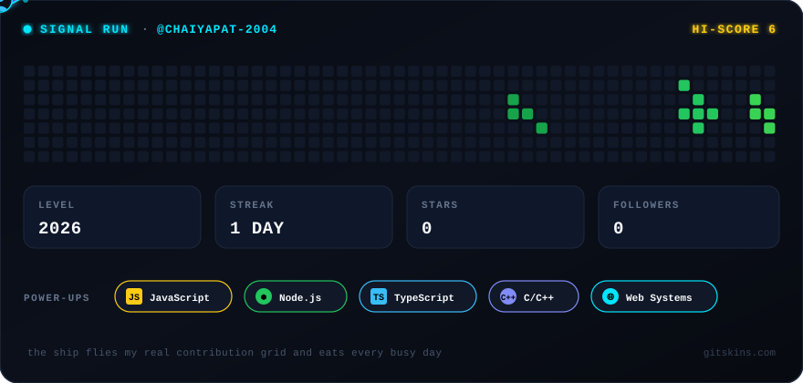

<!-- ================================================================= -->
<!-- SIGNAL RUN // SECTOR 2026 · PILOT @CHAIYAPAT-2004                -->
<!-- Aesthetic: Retro-Futurism Arcade Space Runner · GitSkins Spec    -->
<!-- ================================================================= -->

<div align="center">

  <!-- Signal Run Pilot Banner -->
  <a href="https://github.com/chaiyapat-2004">
    
  </a>

  <p align="center">
    <i>"A ship with you as the pilot flies your real contribution grid."</i><br/>
    <sub>🎮 Level is the GitHub matrix — every commit charges the thrusters.</sub>
  </p>

  <p align="center">
    
    
    
  </p>

</div>

---

### 🛰️ `PILOT LOG // TELEMETRY & ABOUT`

```yaml
Pilot: Chaiyapat
Callsign: @chaiyapat-2004
Class: Computer Engineering (EGCI) @ Mahidol University
Sector: Bangkok, Thailand 🇹🇭
Current Quest: Bootstrapping full-stack side quests & open-source missions
Roast Diagnosis: 8/100 ("A digital abandoned parking lot with Morse code commits")
Mission Directive: Overdrive active. Turning a single-node HTTP server into a fleet.
```

> **Incoming Transmission from GitSkins Roast:**  
> *"You've got 1 repo and 3 contributions. Even a calculator has more history than this profile."*  
> 🛸 **System Response:** *Challenge accepted. Thrusters engaged, warp drive spooling up.*

---

### ⚡ `POWER-UPS // SHIP MODULES & TECH STACK`

<div align="center">

| Core Weaponry (Languages) | Propulsion (Backend & Systems) | Navigation & Tools |
| :--- | :--- | :--- |
|  |  |  |
|  |  |  |
|  |  |  |
|  |  |  |

</div>

---

### 🚀 `MISSIONS // FLIGHT LOG & REPOSITORIES`

* **`01` · [egci427-2026-ex01](https://github.com/chaiyapat-2004/egci427-2026-ex01)**  
  `[STATUS: COMPLETED]` Computer Engineering Web Systems Lab practice HTTP service running on Node.js core.
* **`02` · [Signal Run Profile](https://github.com/chaiyapat-2004/chaiyapat-2004)**  
  `[STATUS: ACTIVE]` Reverse-engineered GitSkins arcade runner cockpit & interactive profile telemetry station.
* **`03` · Side Quests & Full-Stack Projects**  
  `[STATUS: CHARGING]` Building modern web apps, distributed systems, and engineering portfolio projects.

---

### 📊 `TACTICAL HUD // REAL-TIME TELEMETRY`

<div align="center">

  
  

</div>

<br/>

<!-- Optional GitSkins Live Dynamic Picture Feed -->
<!-- If you prefer pulling the raw dynamic SVG from GitSkins cloud: -->
<details>
<summary>🛰️ <b>Toggle Live GitSkins Dynamic Sections (Cloud Sync)</b></summary>
<br/>

<picture>
  <source media="(prefers-color-scheme: light)" srcset="https://www.gitskins.com/api/section/signal-grid?username=chaiyapat-2004&mode=light&v=2026-11-11" />
  
</picture>

<picture>
  <source media="(prefers-color-scheme: light)" srcset="https://www.gitskins.com/api/section/signal-about?username=chaiyapat-2004&mode=light&v=2026-11-11" />
  
</picture>

<picture>
  <source media="(prefers-color-scheme: light)" srcset="https://www.gitskins.com/api/section/signal-list?username=chaiyapat-2004&mode=light&v=2026-11-11" />
  
</picture>

<picture>
  <source media="(prefers-color-scheme: light)" srcset="https://www.gitskins.com/api/section/signal-stack?username=chaiyapat-2004&mode=light&v=2026-11-11" />
  
</picture>

</details>

---

### 📡 `COMMUNICATION FREQUENCIES`

<div align="center">
  
  <a href="https://github.com/chaiyapat-2004">
    
  </a>
  &nbsp;
  <a href="mailto:chaiyapat@example.com">
    
  </a>

</div>

<br/>

<div align="center">
  <sub>SIGNAL RUN · Reverse Engineered from <a href="https://www.gitskins.com/templates/signal-run">GitSkins</a> · Pilot Sector 2026</sub>
</div>
